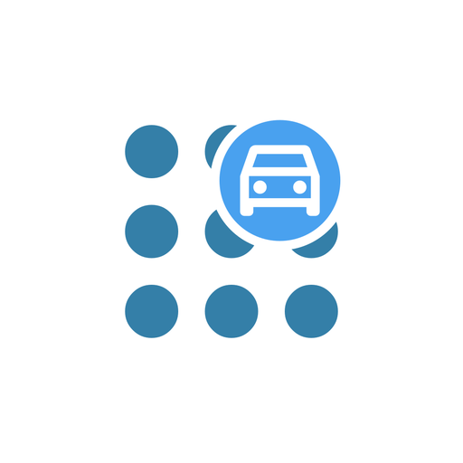
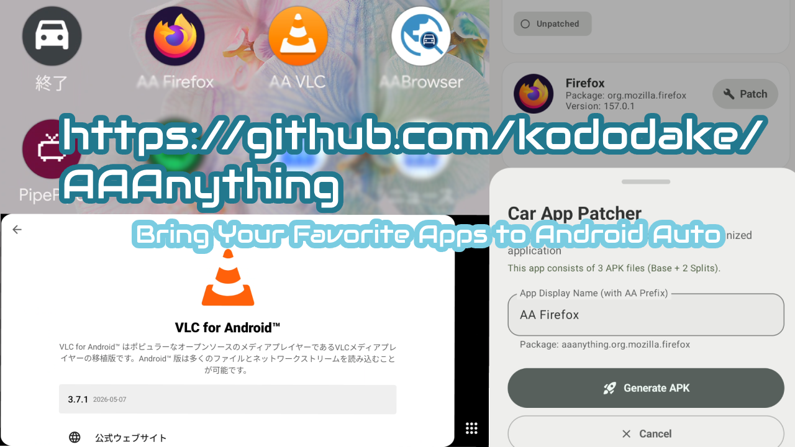

#  AA Anything — अपने पसंदीदा ऐप्स कार की बड़ी स्क्रीन पर चलाएं! (हिन्दी)

> 🚀 **अपनी कार के डिस्प्ले को नया रूप दें!**  
> क्या आप Android Auto में सीमित ऐप्स से परेशान हैं? खास तौर पर **Android 15 और नए वर्ज़न** के लिए डिज़ाइन किया गया **AA Anything** बिना फोन रूट (No Root) किए आपके फोन के **विभिन्न प्रकार के ऐप्स** (DRM कॉपीराइट सुरक्षा या सुरक्षा प्रतिबंधों वाले कुछ ऐप्स को छोड़कर) को कार स्क्रीन पर चलाने की सुविधा देता है!

  

---

## 🌐 भाषा / Languages

- [English (अंग्रेज़ी)](README.md)
- [日本語 (जापानी)](README.ja.md)
- [Русский (रूसी)](README.ru.md)
- [हिन्दी (Hindi)](README.hi.md) (वर्तमान)

---

## 💡 मुख्य विशेषताएँ

- **विस्तृत ऐप अनुकूलता (DRM या सुरक्षा प्रतिबंधों वाले ऐप्स को छोड़कर):** वीडियो, ऑडियो और उपयोगिता ऐप्स सीधे कार स्क्रीन पर चलाएं और नियंत्रित करें।
- **रूट की आवश्यकता नहीं:** फोन में किसी बदलाव या कंप्यूटर के बिना सीधे फोन से आसान सेटअप।
- **सहज इन-प्लेस अपडेट:** नए संस्करण या सिस्टम अपडेट आने पर पैच किए गए ऐप्स को आसानी से अपडेट रखें।
- **कार डिस्प्ले के अनुकूल:** कार की स्क्रीन और टचस्क्रीन के लिए उपयुक्त दृश्य लेआउट।
- **मुफ्त मीडिया प्लेयर समर्थन:** वीएलसी (VLC) जैसे लोकप्रिय मीडिया प्लेयर मुफ्त में उपलब्ध हैं।

---

## 🚀 3 आसान चरणों में शुरू करें

1. **AA Anything डाउनलोड करें:** [GitHub Releases (Latest)](https://github.com/kododake/AAAnything/releases/latest) से नवीनतम APK डाउनलोड करें और इंस्टॉल करें।
2. **Android Auto में Unknown sources चालू करें:** नीचे दिए गए निर्देश का पालन करें (केवल एक बार)।
3. **ऐप चुनें और कार में चलाएं:** AA Anything में ऐप चुनें, **Patch & Install** दबाएं और कार से कनेक्ट करें!

---

## 🛠️ Android Auto में Unknown sources कैसे चालू करें

कार स्क्रीन पर ऐप्स को प्रदर्शित करने के लिए Android Auto में डेवलपर सेटिंग्स चालू करना आवश्यक है:

1. **Android Auto सेटिंग्स खोलें:** फोन की सेटिंग्स में "Android Auto" खोजें और खोलें।
2. **डेवलपर मोड अनलॉक करें:** नीचे स्क्रॉल करें और **"Version" पर लगातार 10 बार टैप करें**। पॉप-अप में "OK" दबाएं।
3. **डेवलपर सेटिंग्स खोलें:** ऊपर दाएँ कोने में तीन डॉट्स मेनू (**⋮**) &rarr; **Developer settings** खोलें।
4. **Unknown sources चालू करें:** सूची में **"Unknown sources"** ढूंढें और उस पर टिक लगाएं।

---

## 🛑 महत्वपूर्ण: सुरक्षा निर्देश (केवल स्थिर वाहन या सह-यात्रियों के लिए)

> ### ⚠️ सख्त सुरक्षा निर्देश एवं नियम
> यह ऐप केवल सुरक्षित रूप से पार्क किए गए वाहन में या सह-यात्रियों द्वारा उपयोग के लिए बनाया गया है। वाहन चलाते समय स्क्रीन देखना या उसका संचालन करना यातायात नियमों व कानूनों के तहत सख्त मना है।
> 
> 1. **केवल सह-यात्रियों या सुरक्षित रूप से पार्क किए गए वाहन के लिए:** सभी डिस्प्ले सुविधाएँ केवल सह-यात्रियों के लिए या सुरक्षित रूप से पार्क होने (जैसे हैंडब्रेक लगा हो) पर उपयोग के लिए हैं। चालक वाहन चलाते समय कभी भी स्क्रीन न देखें और न ही चलाएं।
> 2. **पूर्ण रूप से स्वयं की ज़िम्मेदारी:** इस एप्लिकेशन या पैच किए गए ऐप्स के उपयोग से होने वाली किसी भी दुर्घटना, यातायात उल्लंघन या नुकसान के लिए डेवलपर उत्तरदायी नहीं होगा।
> 3. **मॉडिफाइड APK शेयर या वितरित न करें:** पैच किए गए ऐप्स केवल आपके व्यक्तिगत डिवाइस के लिए बनते हैं। वे अन्य डिवाइसों पर काम नहीं करेंगे और उन्हें साझा करना सख्त वर्जित है।

विस्तृत कानूनी शर्तों के लिए [Terms of Service & EULA](TERMS_OF_SERVICE.md) ([Web संस्करण](terms.html)) देखें।

---

## 🛡️ गोपनीयता (Privacy)
आपकी गोपनीयता सुरक्षित है:

> [!NOTE]
> - 🕵️ **सेल्फ-होस्टेड एनालिटिक्स:** हम निजी **Umami** का उपयोग करते हैं। कोई IP ट्रैकिंग नहीं और कोई बिग टेक ट्रैकर्स नहीं।
> - 📊 **न्यूनतम अनाम आँकड़े:** केवल **ऐप लॉन्च की संख्या** और **ऐप संस्करण** की गणना की जाती है। अन्य कोई डेटा एकत्र नहीं किया जाता।

---

## 📄 कानूनी दस्तावेज़

- [Terms of Service & EULA (English / Markdown)](TERMS_OF_SERVICE.md)
- [Terms of Service & EULA (Web HTML)](https://kododake.github.io/AAAnything/terms.html)
- [Privacy Policy (Web HTML)](https://kododake.github.io/AAAnything/privacy.html)
- [GitHub Pages Official Site](https://kododake.github.io/AAAnything/)

---

## 👤 लेखक

- **लेखक:** Kododake ([AA Browser](https://github.com/kododake/AABrowser) के डेवलपर)
- **रिपॉजिटरी:** [https://github.com/kododake/AAAnything](https://github.com/kododake/AAAnything)
